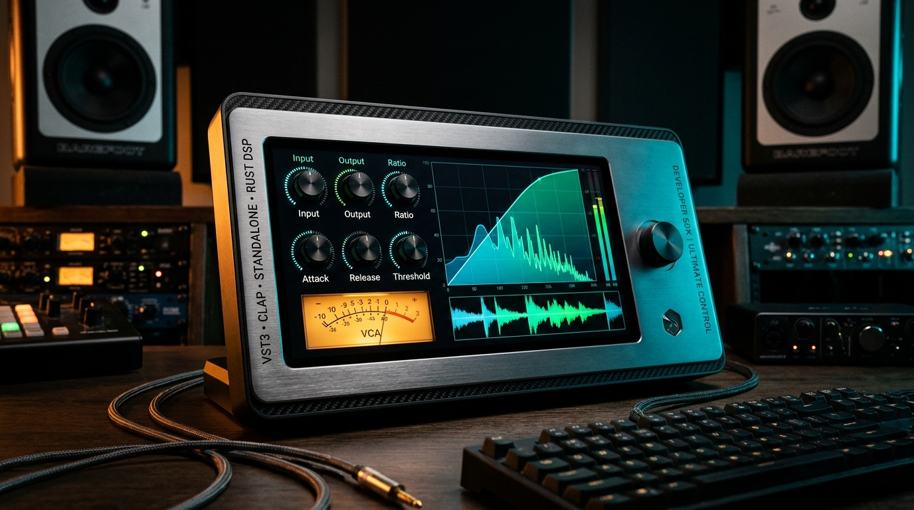
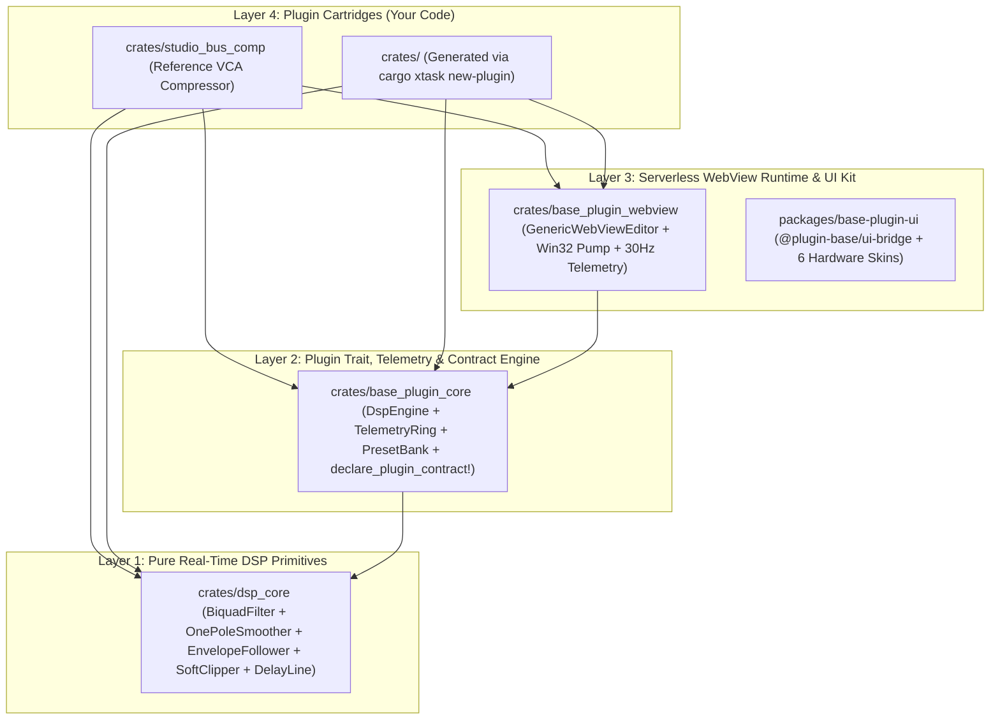

<div align="center">



<br />

# Open Audio Stack (`rust-webview-vst-template`)

**Production-Grade Rust (`nih-plug`) + Serverless WebView2/WebKit (`wry`) + 6-Skin `@audio-ui` SDK for VST3, CLAP & Standalone Audio Plugins**

[](https://github.com/davidcastilloc/rust-webview-vst-template/actions/workflows/ci.yml)
[](https://github.com/davidcastilloc/rust-webview-vst-template/releases)
[](https://davidcastilloc.github.io/rust-webview-vst-template/)
[](llms.txt)
[-10b981.svg)](scripts/audit_plugin_architecture.ps1)
[](CONTRIBUTING.md)

[**Interactive Docs & Live 6-Skin Preview**](https://davidcastilloc.github.io/rust-webview-vst-template/) · [**Vibe-Coding Prompt Recipes**](docs/VIBE_CODING_PROMPTS.md) · [**AI Context (`llms.txt`)**](llms.txt) · [**Full SDK Reference (`llms-full.txt`)**](llms-full.txt) · [**Contributing Guide**](CONTRIBUTING.md)

</div>

---

## Why Open Audio Stack?

Building commercial VST3 and CLAP audio plugins traditionally forces an uncomfortable trade-off between **low-level C++/Rust audio performance** and **expressive, hardware-grade UI design**.

**Open Audio Stack (`rust-webview-vst-template`)** solves both with a 4-layer architecture designed for both **DSP engineers** and **AI-assisted Vibe Coders**:

1. **Zero-Allocation Real-Time Rust DSP (`crates/dsp_core`)**: Lock-free, denormal-protected DSP building blocks (`BiquadFilter`, `OnePoleSmoother`, `EnvelopeFollower`, `SoftClipper`, and stack-allocated `DelayLine<N>` with 4-point Hermite interpolation).
2. **Mathematical UI $\leftrightarrow$ DSP Contract Verification (`declare_plugin_contract!`)**: Every rotary knob and toggle button in the HTML/React UI is mathematically proven during `cargo test` to exist in the DOM and produce a measurable acoustic change in the audio output buffer (`AmplifiesRms`, `AttenuatesRms`, `AltersFrequencyResponse`, `MutatesTransient`, `MutatesWaveform`, or `PassThroughEqual`). **Dead or disconnected UI controls fail CI automatically.**
3. **Hardened Serverless WebView Host (`crates/base_plugin_webview`)**: Embeds your entire 6-Skin UI directly into the binary via `include_str!` (zero localhost HTTP servers or port collisions), complete with a dedicated Win32 `HWND_MESSAGE` timer pump (`SetTimer` + `PeekMessageW`) and per-executable WebView2 User Data Folder isolation.
4. **First-Class AI & Vibe-Coder Experience (`llms.txt` + `llms-full.txt`)**: Point **Claude Code**, **Cursor**, **Antigravity**, or **Windsurf** at this repository and generate complete, 4-Gate certified audio plugins in minutes.

---

## Table of Contents

- [4-Layer Architecture Overview](#4-layer-architecture-overview)
- [Quickstart (Create Your Plugin in 60 Seconds)](#quickstart-create-your-plugin-in-60-seconds)
- [Vibe-Coding & AI Agent Guide (`llms.txt`)](#vibe-coding--ai-agent-guide-llmstxt)
- [The 4 Automated Certification Gates](#the-4-automated-certification-gates)
- [Ecosystem SDK Auto-Sync (Updating Existing Plugins)](#ecosystem-sdk-auto-sync-updating-existing-plugins)
- [Semantic Release & Automated Binary Packaging](#semantic-release--automated-binary-packaging)
- [Governance, Security & Contributing](#governance-security--contributing)

---

## 4-Layer Architecture Overview



| Layer | Path | Purpose | Touch When Creating a New Plugin? |
| :--- | :--- | :--- | :--- |
| **Layer 1** | `crates/dsp_core` | Zero-allocation filters, smoothers, saturators, envelopes & delay lines | **Never** (Shared SDK) |
| **Layer 2** | `crates/base_plugin_core` | `DspEngine` trait, lock-free `TelemetryRing`, `PresetBank`, `declare_plugin_contract!` | **Never** (Shared SDK) |
| **Layer 3** | `crates/base_plugin_webview` & `packages/base-plugin-ui` | Native WebView2/WebKit host, IPC router & 6-Skin `@audio-ui` components | **Never** (Shared SDK) |
| **Layer 4** | `crates/<your_plugin_slug>` | Your custom DSP algorithm, 6-Skin UI & parameter contract | **Yes (100% of your work lives here)** |

---

## Quickstart (Create Your Plugin in 60 Seconds)

### 1. Create Your Repository from This Template
Click **[Use this template](https://github.com/davidcastilloc/rust-webview-vst-template/generate)** on GitHub (or clone directly):

```powershell
git clone https://github.com/davidcastilloc/rust-webview-vst-template.git my-audio-plugin
cd my-audio-plugin
```

### 2. Scaffold a New Plugin Crate (`new-plugin`) or Rename the Default Crate (`init-template`)

- **Option A — Add a brand-new plugin cartridge alongside the reference compressor**:
  ```powershell
  cargo run --package xtask -- new-plugin --name "Tape Warmth" --vendor "AcmeAudio" --id "com.acmeaudio.tapewarmth"
  ```
- **Option B — Rename the reference `studio_bus_comp` crate in-place**:
  ```powershell
  cargo run --package xtask -- init-template --name "Tape Warmth" --vendor "AcmeAudio" --id "com.acmeaudio.tapewarmth"
  ```

### 3. Run the 4-Gate Certification Audit
```powershell
powershell -ExecutionPolicy Bypass -File scripts/audit_plugin_architecture.ps1
```

### 4. Build Standalone `.exe`, `.vst3`, and `.clap` Bundles
```powershell
# Build Standalone desktop application
cargo build --release -p tape_warmth --bin tape_warmth_app

# Bundle VST3 and CLAP plugins into target/bundled/
cargo run --package xtask -- bundle tape_warmth --release
```

---

## Vibe-Coding & AI Agent Guide (`llms.txt`)

This repository is engineered from the ground up for **AI-Assisted Audio Plugin Development ("Vibe Coding")**:

| File | Purpose for AI Agents |
| :--- | :--- |
| [`llms.txt`](llms.txt) | Concise index of the 4-layer architecture, CLI generators, and 4 certification gates. |
| [`llms-full.txt`](llms-full.txt) | Complete single-file API reference (`dsp_core`, `DspEngine`, `declare_plugin_contract!`, IPC JSON protocol) ready to drop into any LLM context window. |
| [`CLAUDE.md`](CLAUDE.md) / [`.cursorrules`](.cursorrules) | Automatic system instructions loaded natively by **Claude Code**, **Cursor**, **Antigravity**, and **Windsurf**. |
| [`docs/VIBE_CODING_PROMPTS.md`](docs/VIBE_CODING_PROMPTS.md) | Copy-pasteable prompt recipes to build Analog Tube Saturators, 4-Band Mastering EQs, Stereo BBD Choruses, and Transient Shapers. |

### Example Vibe-Coder Prompt (Copy & Paste into Your AI Agent)

```text
Read llms.txt and llms-full.txt.
Use `cargo run --package xtask -- new-plugin --name "Velvet Warmth" --vendor "VibeAudio" --id "com.vibeaudio.velvetwarmth"` to scaffold a new plugin crate, then customize `crates/velvet_warmth` into a stereo asymmetric tube & tape saturator using `dsp_core::SoftClipper::process_asymmetric_tube` and `dsp_core::BiquadFilter`. Include all 6 hardware skins (`minimal`, `dark`, `retro`, `synth70`, `gunmetal`, `phosphor`), register every knob in `declare_plugin_contract!`, and run `powershell -ExecutionPolicy Bypass -File scripts/audit_plugin_architecture.ps1` until all 4 Gates pass.
```

---

## The 4 Automated Certification Gates

Every commit and Pull Request is verified by [`scripts/audit_plugin_architecture.ps1`](scripts/audit_plugin_architecture.ps1):

1. **`GATE-01` (Zero Domain Leakage)**: Guarantees `crates/dsp_core`, `crates/base_plugin_*`, and `packages/base-plugin-ui` remain 100% generic and reusable.
2. **`GATE-02` (Real-Time Audio Thread Safety)**: Scans `process()` implementations to forbid heap allocations (`Vec::new`, `Box::new`, `String`, `format!`) and blocking locks (`Mutex::lock`, `RwLock`, `println!`).
3. **`GATE-03` (Clean Workspace Dependency DAG)**: Verifies unidirectional dependencies (`dsp_core` $\rightarrow$ `base_plugin_core` $\rightarrow$ `base_plugin_webview` $\rightarrow$ `<plugin>`).
4. **`GATE-04` (Mathematical UI $\leftrightarrow$ DSP Contract)**: Runs `declare_plugin_contract!` unit tests across all crates, proving every UI control (`id="knob-..."`) is present in `ui/dist/index.html`, all 6 skins exist, and every parameter measurably alters the audio signal.

---

## Ecosystem SDK Auto-Sync (Updating Existing Plugins)

Because your plugin lives inside `crates/<your_plugin_slug>` while the shared SDK lives in `crates/dsp_core`, `crates/base_plugin_core`, and `crates/base_plugin_webview`, you can upgrade any derived plugin repository whenever the template SDK releases improvements:

```powershell
# Add the template repository as an upstream remote (once)
git remote add template https://github.com/davidcastilloc/rust-webview-vst-template.git

# Pull the latest SDK improvements into your plugin repository at any time
powershell -ExecutionPolicy Bypass -File scripts/sync_from_template.ps1
```

---

## Semantic Release & Automated Binary Packaging

This repository includes full **Semantic Release** automation ([`.releaserc.json`](.releaserc.json) + [`.github/workflows/release.yml`](.github/workflows/release.yml)):
- Pushing Conventional Commits (`feat: ...`, `fix: ...`, `perf: ...`) to `main` automatically calculates the next semantic version, updates all workspace `Cargo.toml` and `package.json` manifests via `cargo run --package xtask -- set-version <version>`, updates [`CHANGELOG.md`](CHANGELOG.md), and publishes compiled **Windows VST3, CLAP, and Standalone `.exe` ZIP artifacts** to GitHub Releases.

---

## Governance, Security & Contributing

We welcome community contributions to `dsp_core`, `base_plugin_core`, `base_plugin_webview`, and `@plugin-base/ui-bridge`!

- [**Contributing Guide (`CONTRIBUTING.md`)**](CONTRIBUTING.md) — Conventional Commits, 4-Gate verification workflow, and PR checklist.
- [**Code of Conduct (`CODE_OF_CONDUCT.md`)**](CODE_OF_CONDUCT.md) — Contributor Covenant v2.1 standards.
- [**Security Policy (`SECURITY.md`)**](SECURITY.md) — Responsible disclosure and WebView2/real-time thread safety guarantees.
- [**Changelog (`CHANGELOG.md`)**](CHANGELOG.md) — Automated Semantic Release history.

---

## License

Distributed under the **MIT License**. Build free or commercial VST3/CLAP plugins without royalty restrictions.
